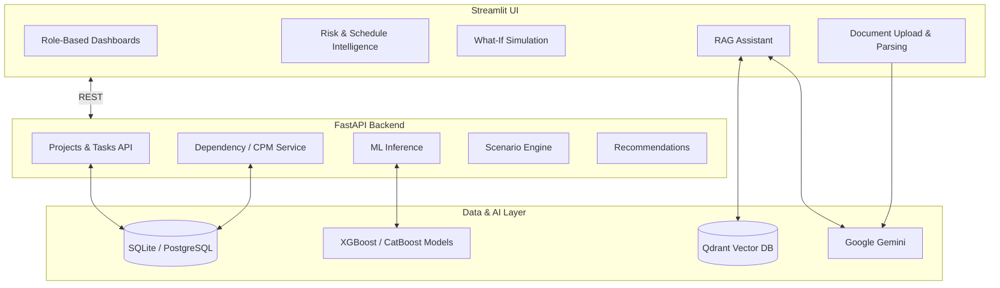

# AI-Driven Enterprise Project Intelligence & Risk Management Platform


[](https://ai-project-1-fv95.onrender.com/)

An end-to-end platform that predicts project risk, forecasts schedule delays, analyses task dependencies and answers questions about project documents using Machine Learning and a RAG-based Generative AI assistant. It supports separate workflows for **IT** and **Non-IT** projects, with role-based access for different job functions.

**Live Demo:** [https://ai-project-1-fv95.onrender.com/](https://ai-project-1-fv95.onrender.com/)

> Hosted on a free Render instance, so the first load may take 30-60 seconds if the app has been idle.

---

## Features

- **AI Risk Prediction**: XGBoost / CatBoost models classify project risk from team, budget, scope, vendor and schedule signals.
- **Schedule Intelligence**: deadline forecasting, milestone tracking and delay impact analysis.
- **Dependency & Critical Path Analysis**: NetworkX-based DAG with Critical Path Method (early/late start and finish, total float) to find bottlenecks and cascade effects.
- **What-If Simulation**: inject delays or resource shocks and see the simulated risk change without touching real data.
- **Prescriptive Recommendations**: prioritised mitigation actions based on root causes.
- **Document Intelligence**: upload project plans (PDF, DOCX, PPTX, CSV) and extract structured project data automatically.
- **RAG Assistant**: chatbot using Gemini embeddings + Qdrant vector DB, grounded in uploaded project documents with source references.
- **Role-Based Access**: workspaces for Backend/Frontend/Full Stack Developer, ML/AI Developer, Data Engineer, QA, DevOps, Project Manager, Team Lead, Business Analyst, Management and more.
- **Separate IT / Non-IT pipelines**: dedicated dashboards, models and pages for each domain.

---

## Model Performance

| Model | Dataset | Accuracy | Precision | Recall | F1 | ROC-AUC |
|---|---|---|---|---|---|---|
| IT Projects (XGBoost) | 30,000 records | 93.49% | 92.28% | 89.80% | 91.02% | 0.986 |
| Non-IT Projects (Tuned XGBoost + ensemble) | 50,000 records | 95.96% | 94.62% | 94.40% | 94.51% | 0.994 |

Non-IT model uses engineered features (frequency encoding, interaction ratios such as milestone stress and complexity pressure) and a tuned decision threshold. The training data is synthetic.

---

## System Architecture



---

## Tech Stack

| Layer | Technologies |
|---|---|
| Frontend | Streamlit, Plotly |
| Backend | FastAPI, Pydantic, SQLAlchemy, Alembic, Uvicorn |
| Database | SQLite (default), PostgreSQL |
| Machine Learning | Scikit-learn, XGBoost, CatBoost, NetworkX, Pandas, NumPy |
| Generative AI | Google Gemini API, Qdrant, PyPDF, PyMuPDF, docx2txt, python-pptx |
| DevOps | Docker, Docker Compose, Pytest |

---

## Project Structure

```
current/
├── AI_project/
│   ├── AI_Project_Risk_Forecasting_System_Combined_KnowledgeBase.pdf
│   └── final_project/
│       ├── app.py                # Streamlit entry point
│       ├── landing.py            # Landing / login page
│       ├── pages/                # IT and Non-IT dashboards, risk, schedule, what-if, assistant
│       ├── utils/                # Parsers, predictor, RBAC, roles, UI helpers
│       ├── rag_chatbot/          # Chunking, embeddings, grounding, chatbot
│       ├── ml_models/            # Trained IT and Non-IT models + metadata
│       ├── backend/              # FastAPI service
│       │   ├── app/              # api, core, ml, models, schemas, services
│       │   ├── alembic/          # DB migrations
│       │   ├── scripts/          # Data generation and seeding
│       │   └── tests/            # API, CPM and ML tests
│       └── requirements.txt
├── it/                           # Sample IT project documents
└── non-it/                       # Sample Non-IT project documents
```

---

## Getting Started

### Prerequisites

- Python 3.11
- A [Gemini API key](https://aistudio.google.com/apikey)
- A [Qdrant Cloud](https://cloud.qdrant.io) cluster (free tier works)

### 1. Clone the repository

```bash
git clone https://github.com/Shuvam-cmd/Development-of-AI-Driven-Enterprise-Project-Intelligence-and-Risk-Management-Platform.git
cd Development-of-AI-Driven-Enterprise-Project-Intelligence-and-Risk-Management-Platform/current/AI_project/final_project
```

### 2. Create environment and install dependencies

```bash
conda create -n project_ai python=3.11 -y
conda activate project_ai
pip install -r requirements.txt
```

### 3. Configure environment variables

Create a `.env` file in `final_project/`:

```ini
GEMINI_API_KEY=your_gemini_api_key
QDRANT_URL=https://your-cluster-url.cloud.qdrant.io
QDRANT_API_KEY=your_qdrant_api_key
```

### 4. Run the app

**Windows (one click):**

```bat
start_all.bat
```

**Manual (two terminals):**

```bash
# Terminal 1: backend
cd backend
set PYTHONPATH=.          # use: export PYTHONPATH=. on Linux/macOS
python -m uvicorn app.main:app --host 127.0.0.1 --port 8000 --reload

# Terminal 2: frontend
python -m streamlit run app.py
```

| Service | URL |
|---|---|
| Streamlit UI | http://localhost:8501 |
| API | http://127.0.0.1:8000 |
| Swagger docs | http://127.0.0.1:8000/docs |

---

## Regenerate Data & Retrain Models

From the `backend/` directory:

```bash
set PYTHONPATH=.
python scripts/generate_training_data.py   # synthetic training data
python -m app.ml.train                     # train models
python scripts/seed.py                     # seed demo project
```

## Run Tests

```bash
cd backend
pytest
```

## Docker (backend + PostgreSQL)

```bash
cd backend
docker compose up --build
```

---

## RAG Pipeline

```
Documents -> Text Extraction -> Chunking -> Embeddings (Gemini) -> Qdrant
        -> Retriever -> Relevant Context -> Gemini LLM -> Grounded Answer + Sources
```

---

## Notes

- Training data is synthetic and meant for demonstration; do not use predictions for real-world decisions without validation on real data.
- Free Qdrant clusters get suspended after inactivity, so reactivate the cluster before a demo.
- Do not commit `.env` or real credentials.

---

## License

Distributed under the MIT License. See [LICENSE](LICENSE) for details.

## Author

**Shuvam Kumar Das**
[GitHub](https://github.com/Shuvam-cmd) · [LinkedIn](https://www.linkedin.com/in/shuvam-kumar-das-664181305/)
